# Wireframes

Low-fidelity layouts for the seven required screens, each followed by a screenshot of the built page (`docs/screenshots/`). Layouts collapse to one column under 1024 px; on phones the navigation becomes a horizontal scroller under the logo.

## 1. Landing page

```
┌──────────────────────────────────────────────────────────────────────┐
│ [φ] XII Physics                                Sign in [Create account]│
├──────────────────────────────────────────────────────────────────────┤
│ NATIONAL SCHOOL CURRICULUM · CLASS XII      ┌──────────────────────────┐│
│ Master Grade XII Physics, one learning      │ Themes & exam weighting  ││
│ outcome at a time.                          │ Electricity & Mag ███ 29%││
│ Practise with questions built from SCF/IG…  │ Waves & Optics    ███ 27%││
│ [Start practising] [Sign in]                │ Atomic, Nuclear…  ██  22%││
│ Demo: karma@demo.bt / teacher@demo.bt       │ Newtonian Mech    █   12%││
│                                             │ Fluids & Thermal  █   10%││
│                                             └──────────────────────────┘│
│ Everything a Class XII learner needs                                   │
│ [Question bank] [7 question types] [Feedback that teaches]            │
│ [Progress]      [AI tutor]         [Built for teachers]               │
│ ┌ Strictly aligned with the curriculum … ───────────────────────────┐ │
└──────────────────────────────────────────────────────────────────────┘
```
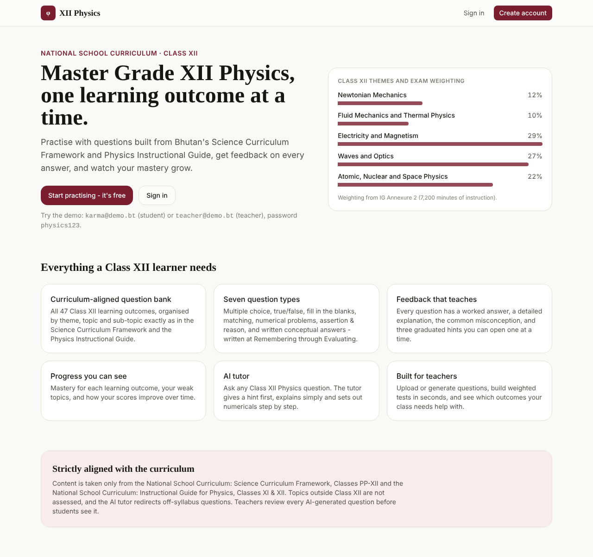

## 2. Student dashboard

```
┌ Kuzuzangpo, Pema                             [Smart review][Choose topics]┐
│ [Average 55%] [Mastered 2/47] [Need work 9] [Improvement +21 pts]         │
│ ┌ Continue ─────────────────────────┐  ┌ Focus areas (< 50% mastery) ──┐ │
│ │ Practice: Electric Circuit [Resume]│  │ XII.FMT.01 · Fluid Mech  !Needs│ │
│ └───────────────────────────────────┘  │ Carry out an experiment…      │ │
│ ┌ Quiz scores over time ─ Chart|Table┐  │ Mastery 0%       [Practise 5] │ │
│ │  100 ┤        ●                     │  │ XII.WO.04 …                   │ │
│ │   50 ┤●──●──●─╯  ╲●── 48%           │  │ …                             │ │
│ └───────────────────────────────────┘  │ See full progress →            │ │
│ ┌ Assigned by your teacher ──────────┐  └───────────────────────────────┘ │
│ │ Unit Test: E&M · 12 q · 30 min [Start]                                 │
│ │ [JOIN CODE][Join class]            │                                    │
└───────────────────────────────────────────────────────────────────────────┘
```
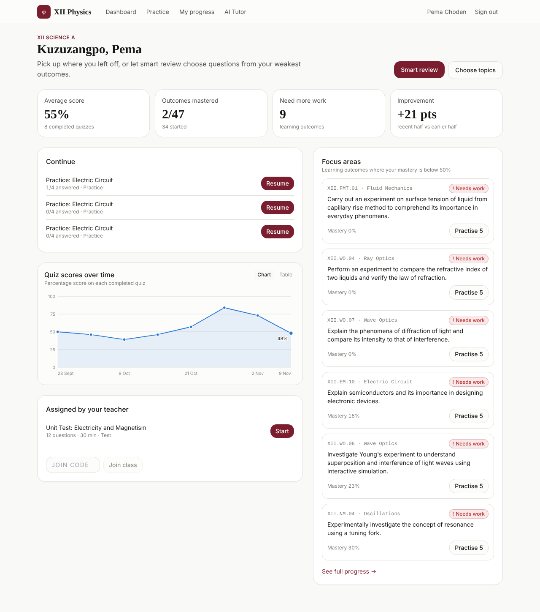

## 3. Topic practice page

```
┌ Choose what to practise ─────────────────────────────────────────────────┐
│ ┌ [x] Electricity and Magnetism  29% · 16 outcomes            − ┐ ┌ Your set ───────┐
│ │  [x] Electric Circuit (12%)                                    │ │ 3 outcomes ·    │
│ │      3.4.1 Classification · 3.4.2 Semiconductors · …           │ │ 9 available     │
│ │      [x] XII.EM.11 Conduct an experiment to verify Kirchhoff…  │ │ Questions [10]  │
│ │          ◐ Learning 62% · 2 questions                          │ │ Types (chips)   │
│ │      [ ] XII.EM.12 Design a model based on potential dividers… │ │ [Start practice]│
│ └────────────────────────────────────────────────────────────────┘ ├ Smart review ───┤
│ ┌ [ ] Waves and Optics …                                      + ┐ │ [Start review]  │
└──────────────────────────────────────────────────────────────────┘ └─────────────────┘
```
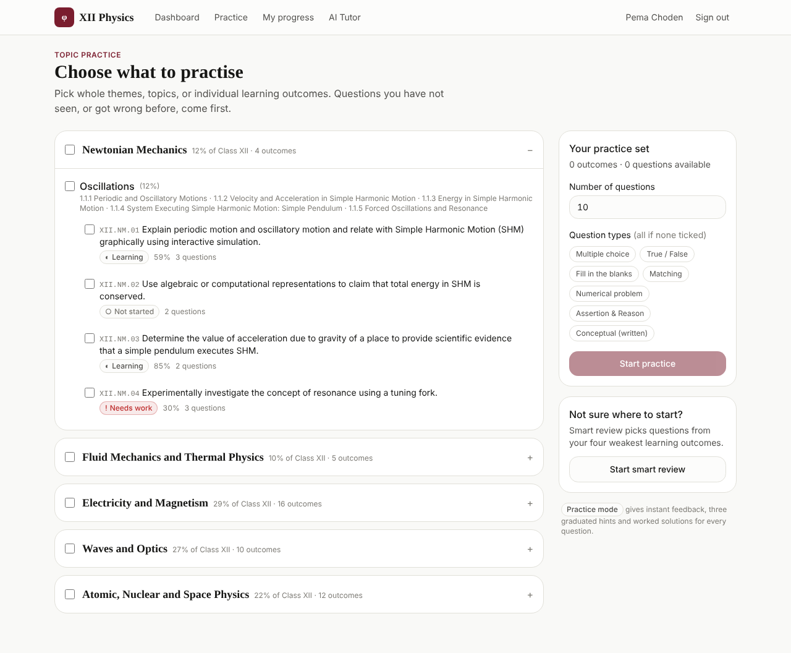

## 4. Quiz page (practice mode, after answering)

```
┌ Question 1 of 4 [Matching][Understanding][XII.EM.09] 1 mark ─┐ ┌ Practice: Electric Circuit ┐
│ Match each type of material with its correct description.    │ │ [1][2][3][4]  (status grid)│
│ Conductor        [ Choose a match… ▾]                        │ │ 1/4 answered               │
│ Insulator        [ … ▾]                                      │ │ [Finish practice]          │
│ 💡 Hint 1: …   (hints revealed one at a time, −15% each)     │ └────────────────────────────┘
│ [Check answer] [Previous] [Next]                             │   Hint penalty note
│ ┌ ✗ Not quite · 0/1 mark after 1 hint ──────────────────────┐ │
│ │ Correct answer · Step-by-step solution · Explanation       │ │
│ │ ┌ Common misconception ┐  ▸ Show all three hints          │ │
│ │ Ask the AI tutor about this question →                     │ │
│ └────────────────────────────────────────────────────────────┘ │
└──────────────────────────────────────────────────────────────┘
Test mode: no hints, "Save answer & next", ⏱ countdown, "Submit test", then result banner and full review.
```
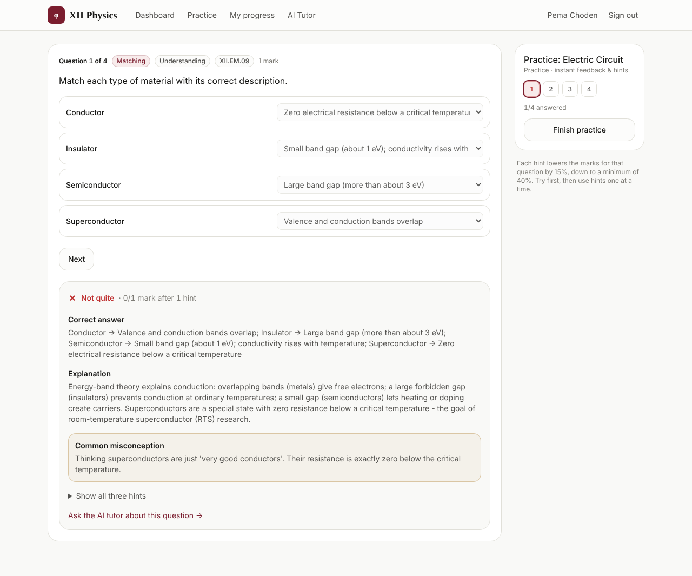 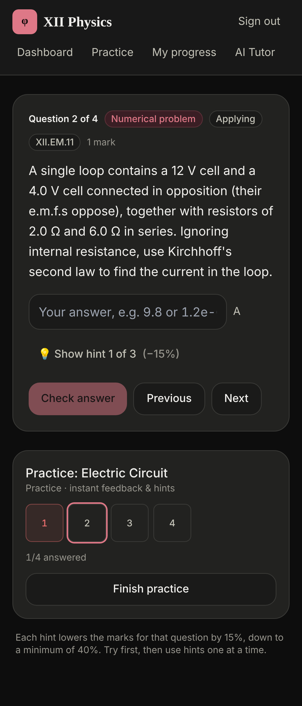

## 5. Analytics page (student; teachers use ?userId=)

```
┌ My progress ───────────────────────────────────────────────────────────┐
│ [Average] [Mastered] [Weak] [Improvement]                              │
│ ┌ Improvement over time ───────────────────────── Chart | Table ┐      │
│ ┌ Topic mastery ──────────────────────────────── Chart | Table ┐       │
│ │ Oscillations        ████████████ 65%                          │       │
│ │ Kinetic Theory      Not started                               │       │
│ ┌ Learning outcomes table: code · statement · ✓/◐/!/○ · % · n · [Practise]┐
└────────────────────────────────────────────────────────────────────────┘
```
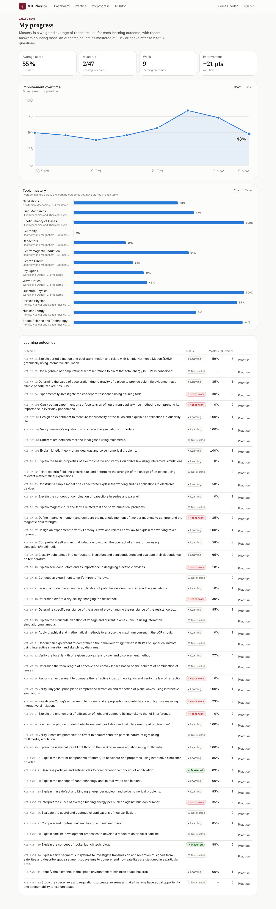

### Class analytics (teacher)

```
┌ XII Science A · join code XIISCA ─────────── [class switcher] ┐
│ [Class avg] [Active] [Need intervention] [Outcomes with activity]│
│ ┌ Weekly trend ┐ ┌ Topic mastery bars ┐                        │
│ ┌ Outcomes requiring intervention: outcome · on track · avg · students ┐
│ ┌ Most-missed concepts: stem · % wrong · likely misconception ┐  │
│ ┌ Students: name · quizzes · average · mastered · weak (→ drill-down) ┐
└───────────────────────────────────────────────────────────────┘
```
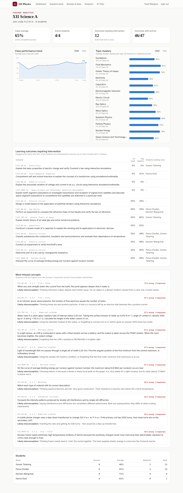

## 6. Teacher dashboard and tools

```
┌ Welcome, Tashi Wangmo                 [Generate a test][Generate questions]┐
│ [Students] [Approved questions] [Drafts to review →] [Need intervention] │
│ ┌ Your classes: name · JOIN CODE · Analytics ┐ ┌ Needs intervention list ┐ │
│ │ [New class ______] [Create class]          │ │ ! XII.EM.01 … 0% on track│ │
│ ┌ Question bank by type ┐                     ┌ Recent quizzes ┐          │
└───────────────────────────────────────────────────────────────────────────┘
Question bank tabs: Browse & review | Write a question | Upload | Generate with AI | IG exemplars
Quizzes: Test generator (title, mode, time, class, count, topic checkboxes with weights,
         Bloom mix, types, [Preview blueprint] [Generate test]) + blueprint panel + quiz list.
```
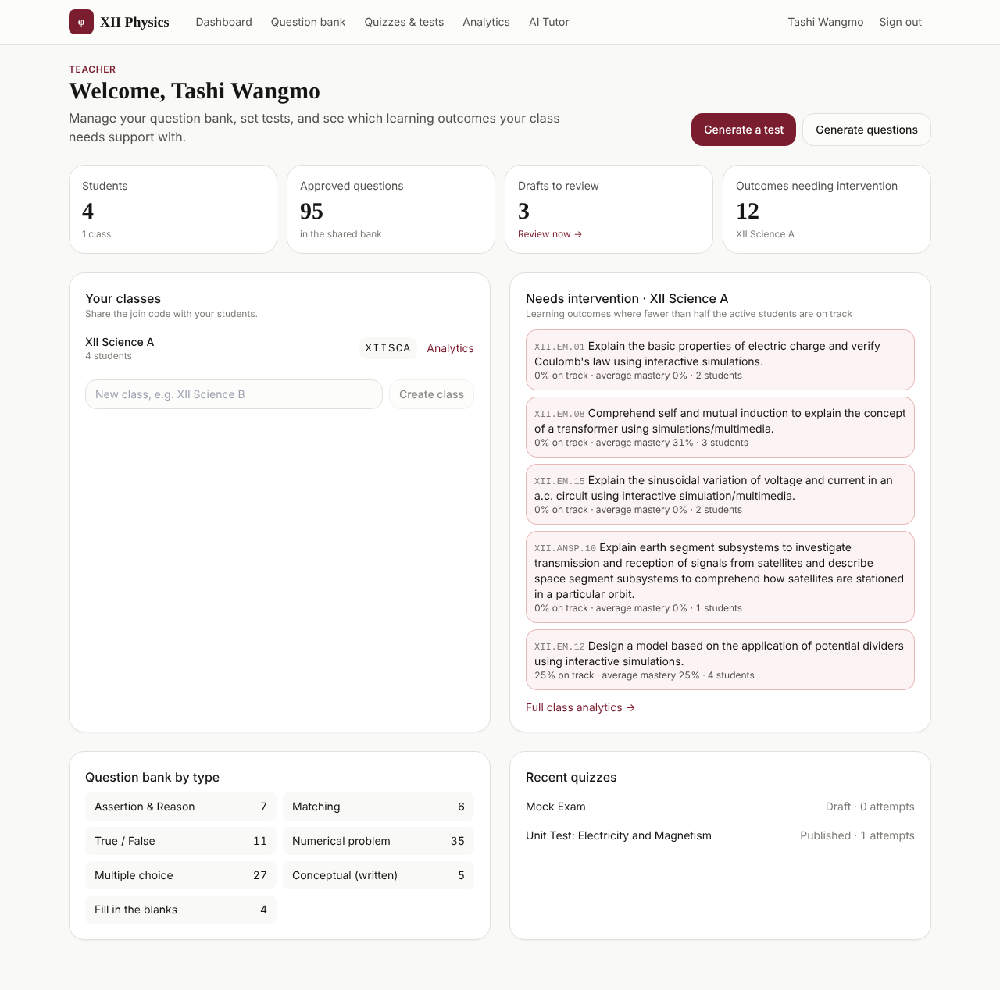 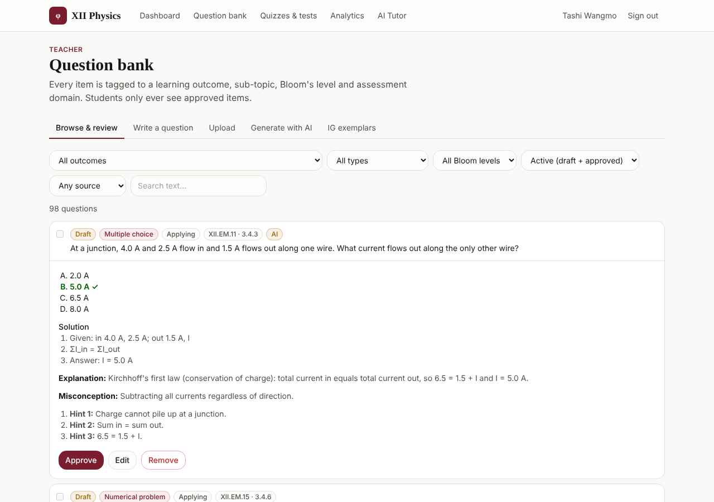 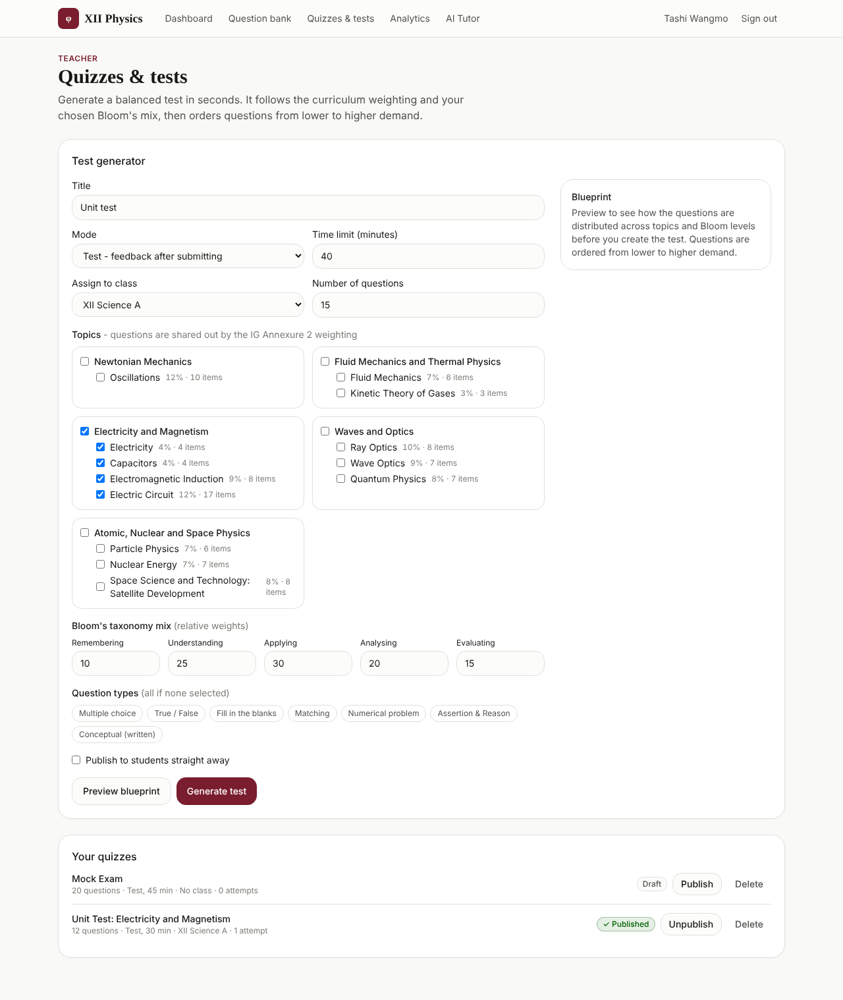

## 7. AI tutor

```
┌ Conversations ┐ ┌──────────────────────────────────────────────────────┐
│ + New         │ │ Ask anything from Class XII Physics                  │
│ Kirchhoff…    │ │ (starter chips)                                      │
│ Photoelectric │ │                     [Help me with Kirchhoff junction]│
│               │ │ **Hint 1:** Think about Kirchhoff's first law …      │
│               │ ├──────────────────────────────────────────────────────┤
│               │ │ [Type your physics question…              ] [Send]   │
└───────────────┘ └──────────────────────────────────────────────────────┘
```
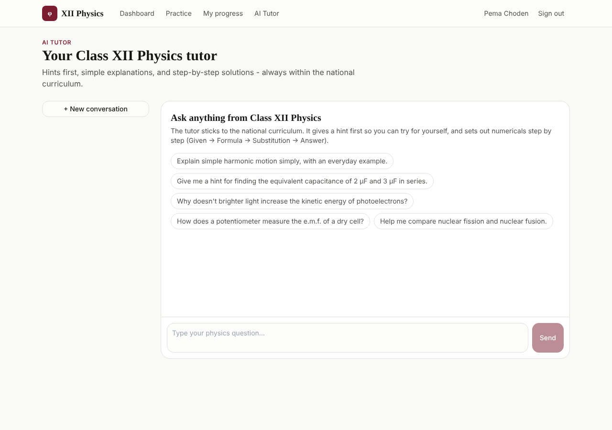
